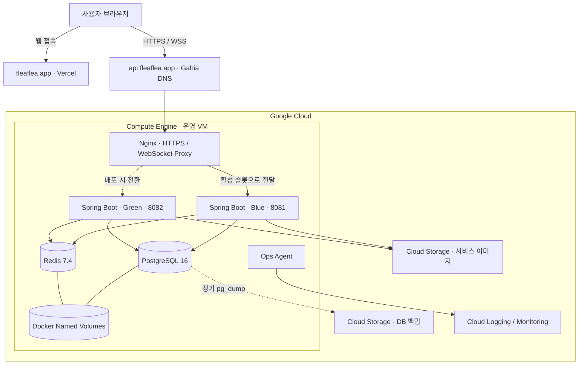

# FleaFlea Backend

친구끼리 플리마켓을 열고, 도감에 등록한 물건을 거래할 수 있는 **FleaFlea**의 백엔드 저장소입니다.

Java와 Spring Boot로 API와 실시간 채팅을 구현했습니다. 프론트엔드는 Vercel, 백엔드는 GCP Compute Engine에서 운영하며, 이미지는 Google Cloud Storage에 저장합니다. 백엔드 배포는 GitHub Actions와 Artifact Registry를 사용하고, 한 VM 안에서 Blue/Green 컨테이너를 전환합니다.

## 서비스 주소

| 구분 | 주소 |
|---|---|
| 웹 서비스 | [fleaflea.app](https://fleaflea.app) |
| 백엔드 API | [api.fleaflea.app](https://api.fleaflea.app) |
| Swagger UI | [API 확인 및 테스트](https://api.fleaflea.app/swagger-ui/index.html) |
| OpenAPI | [API 명세 JSON](https://api.fleaflea.app/v3/api-docs) |
| 상태 확인 | [Readiness](https://api.fleaflea.app/readyz) |
| 기술 기록 | [팀 Wiki](https://github.com/hyundai-autoever-team3/fleaflea-backend/wiki) |

## 기술 스택

| 구분 | 기술 |
|---|---|
| 언어·프레임워크 | Java 25, Spring Boot 4.1.1 |
| 인증 | Spring Security, JWT, OAuth2/OIDC |
| 데이터 접근 | Spring Data JPA, QueryDSL |
| 데이터베이스 | PostgreSQL 16, Flyway |
| 동시성·이벤트 전달 | Redis 7.4, Redisson, Spring Data Redis |
| 실시간 채팅 | WebSocket, STOMP |
| 이미지 저장 | Google Cloud Storage, V4 Signed URL |
| 서버·컨테이너 | Compute Engine, Docker Compose, Nginx |
| HTTPS | Let's Encrypt, Certbot |
| CI/CD | GitHub Actions, Artifact Registry, Workload Identity Federation, IAP |
| 운영 관측 | Cloud Logging, Cloud Monitoring, Ops Agent |
| 테스트 | JUnit, Testcontainers, k6 |
| API 문서 | Springdoc OpenAPI, Swagger UI |

## 주요 기능

| 영역 | 기능 |
|---|---|
| 회원·인증 | JWT 인증, Google·카카오·네이버 OAuth2/OIDC 로그인 |
| 마켓 | 마켓 생성·수정·삭제, 초대 코드 발급, 참여·탈퇴 |
| 도감 | 물건 등록·수정·삭제, 이미지 및 공개 여부 관리 |
| 상품·거래 | 상품 등록과 조회, 거래 요청 처리 |
| 친구·채팅 | 친구 관계 기반 1:1 채팅방, 메시지 이력, 읽음 및 입력 중 이벤트 |
| 이미지 | 이미지 업로드·조회·삭제 |

채팅 백엔드는 구현과 서버 간 전달 검증을 마쳤습니다. 프론트엔드 연동과 실제 화면에서의 재접속 검증은 별도로 진행합니다.

## 운영 아키텍처

Blue와 Green은 같은 VM에서 실행되며 PostgreSQL과 Redis를 공유합니다. 평소에는 활성 앱 컨테이너가 요청을 처리하고, 배포할 때 반대쪽 슬롯을 실행해 트래픽을 전환합니다. 그림의 Blue는 활성 슬롯의 예시입니다.

### 네트워크

| 대상 | 포트 | 접근 방식 |
|---|---:|---|
| 프론트엔드 | 443 | Vercel HTTPS |
| Nginx | 80 | 인증서 검증 및 HTTPS 리다이렉트 |
| Nginx | 443 | REST API, Swagger, WebSocket |
| SSH | 22 | IAP 경유, OS Login으로 접근 제어 |
| 앱 Blue / Green | 8081 / 8082 | 호스트의 `127.0.0.1`에 바인딩, 컨테이너 내부는 8080 |
| PostgreSQL | 5432 | Docker 내부 및 호스트 Loopback |
| Redis | 6379 | Docker 내부 및 호스트 Loopback |

앱·PostgreSQL·Redis 포트를 인터넷에 직접 공개하지 않습니다. DB 관리 도구는 IAP와 SSH 포트 포워딩으로 연결합니다. 브라우저 접근은 CORS와 WebSocket 허용 Origin 설정으로 관리합니다.

## 데이터와 실시간 처리

### PostgreSQL과 Flyway

서비스 데이터는 PostgreSQL에 저장하고, 스키마 변경은 Flyway 마이그레이션으로 관리합니다. PostgreSQL 데이터는 Docker Named Volume에 보관하므로 컨테이너 재생성과 데이터 삭제는 구분됩니다.

Named Volume은 컨테이너 교체 시 데이터를 유지하기 위한 저장소입니다. VM이나 디스크 장애에 대비한 외부 백업은 별도로 수행합니다.

### Redis

Redis는 다음 두 가지 용도로 사용합니다.

- **마켓·도감 분산 락:** Redisson으로 같은 마켓 또는 도감 아이템의 변경을 직렬화합니다. DB 잠금과 제약 조건도 함께 사용합니다.
- **채팅 Pub/Sub:** 서로 다른 앱 프로세스에 연결된 사용자에게 메시지·읽음·입력 중 이벤트를 전달합니다.

마켓 분산 락은 데이터 정합성을 위한 장치입니다. 응답 속도를 높이기 위한 조회 캐시와는 목적이 다르며, 경합이 발생하면 락 대기 시간이 추가됩니다. 도감도 Redis 락과 기존 DB 잠금을 함께 사용합니다. 적용 범위와 배포 시 공존 조건은 [Redisson 락 안내](docs/concurrency/redisson-locks.md)를 참고하세요.

### WebSocket 채팅

클라이언트는 `wss://api.fleaflea.app/ws/chat`에 연결한 뒤 STOMP 프로토콜을 사용합니다. STOMP `CONNECT`에서 JWT를 검증하며, 채팅방 접근 권한도 확인합니다.

메시지 이력은 PostgreSQL에 저장합니다. Redis Pub/Sub은 실시간 이벤트 전달에 사용하며, 재접속 후 누락된 메시지는 REST API로 조회합니다. Pub/Sub 자체를 영구 메시지 저장소로 사용하지 않습니다.

배포로 이전 프로세스가 종료되면 기존 WebSocket 연결이 끊길 수 있습니다. 클라이언트는 재접속·재구독과 메시지 이력 복구를 처리해야 합니다.

## 이미지 저장

운영 이미지는 비공개 **Google Cloud Storage(GCS)** 버킷에 저장합니다. 애플리케이션은 VM에 연결된 서비스 계정으로 접근하며, 이미지 조회에는 만료 시간이 있는 V4 Signed URL을 발급합니다.

DB에는 이미지 키를 보관하고, 조회 시 접근 URL을 생성합니다. 기본 URL 유효 기간은 1시간이며 환경 변수로 조정할 수 있습니다.

이미지 저장 구현은 `IMAGE_STORAGE` 설정으로 선택합니다. 운영은 `gcs`를 사용하고, S3 구현은 로컬 MinIO 테스트 등에 사용할 수 있도록 남아 있습니다.

## CI/CD와 Blue/Green 배포

```mermaid
flowchart LR
    MAIN["main Push / PR 병합"] --> CI["Gradle Build / Test"]
    CI --> BUILD["Docker Image Build"]
    BUILD --> REGISTRY["Artifact Registry"]
    REGISTRY --> DEPLOY["IAP SSH · deploy.sh"]
    DEPLOY --> START["비활성 슬롯 실행"]
    START --> HEALTH["새 컨테이너 상태 확인"]
    HEALTH --> SWITCH["Nginx upstream 전환"]
    SWITCH --> WATCH["전환 후 상태 관찰"]
    WATCH --> STOP["기존 연결 대기 후 이전 컨테이너 종료"]
```

`main`의 CI가 성공하면 GCP CD가 해당 커밋의 이미지를 빌드·업로드하고 배포합니다. GitHub Actions는 Workload Identity Federation으로 GCP에 인증하므로 장기 서비스 계정 키 파일을 저장하지 않습니다.

배포는 이미지 digest를 기준으로 진행하며 다음 순서로 실행합니다.

1. 비활성 슬롯에서 새 앱을 실행하고 상태 확인을 기다립니다.
2. Nginx upstream을 새 슬롯으로 전환합니다.
3. 60초 동안 상태를 관찰합니다. 확인 실패 또는 새 upstream의 API 요청 20건 이상에서 5xx 비율이 5%를 초과하면 이전 upstream으로 복구합니다.
4. 검증이 끝나면 활성 슬롯과 롤백 이미지 정보를 기록합니다.
5. 기존 연결을 위해 90초 대기한 뒤 이전 앱을 graceful shutdown합니다. 컨테이너 종료 유예는 75초입니다.

이 방식은 앱 교체 중 HTTP 요청의 중단을 줄이기 위한 구성입니다. 단일 VM 장애에 대한 자동 고가용성 전환이나 WebSocket 연결의 영구 유지를 제공하지는 않습니다. DB 스키마 변경도 이전 앱과의 호환성을 고려해야 합니다.

## 백업·모니터링·자동 정리

아래 시간은 **한국 시간(KST)** 기준입니다. 운영 설정은 적용했으며, 관련 코드 변경은 [PR #181](https://github.com/hyundai-autoever-team3/fleaflea-backend/pull/181)에서 관리합니다.

| 항목 | 운영 방식 |
|---|---|
| DB 백업 | 매일 03:00 `pg_dump` 후 별도 비공개 GCS 버킷에 저장 |
| 백업 확인 | GCS에서 다시 다운로드하고 SHA-256 검증 |
| 복원 검증 | 매주 일요일 03:30 임시 DB에 복원·조회 후 검증 DB 삭제 |
| 백업 보관 | 30일 후 삭제, 버킷 soft delete 7일 별도 적용 |
| 디스크 스냅샷 | 매일 03:00부터 예약 실행, 예약 스냅샷 14일 보관 |
| 로그 | Ops Agent로 Nginx·Docker·유지보수 로그를 Cloud Logging에 수집 |
| 장애 알림 | HTTPS 상태, CPU·메모리·디스크, 컨테이너 이상, 유지보수 실패·지연 이메일 알림 |
| API 지표 | 관리 요청을 제외한 API 요청의 5xx 비율과 p95 응답 시간 수집 |
| VM 이미지 정리 | 매일 04:00 실행·중지 컨테이너, 양쪽 슬롯, 최신 프로젝트 이미지 3개를 보존하고 미사용 이미지 정리 |
| 레지스트리 정리 | 최신 10개와 `prod-*` 태그를 보존하고, 나머지 7일 경과 이미지 정리 |

예약 작업은 지연 시간이 붙거나 실행 창 안에서 시작될 수 있습니다. 최초 수동 스냅샷은 예약 스냅샷의 자동 보관 정책과 별개입니다.

이미지 정리와 배포는 같은 잠금을 사용합니다. 정리 작업은 데이터 볼륨이나 컨테이너를 prune하지 않고, 이미지를 강제로 삭제하지 않습니다.

## 설정 관리

운영 설정은 Git 저장소와 분리해 서버의 `/etc/fleaflea`에서 관리합니다. 주요 파일은 다음과 같습니다.

| 파일 | 역할 |
|---|---|
| `fleaflea.env` | 앱·DB 연결·JWT·OAuth·CORS·GCS 설정 |
| `postgres.env` | PostgreSQL 컨테이너 설정 |
| `redis.env` | Redis 연결 및 인증 설정 |
| `blue.env`, `green.env` | 슬롯별 이미지 URI와 호스트 포트 |
| `active-slot` | 현재 활성 슬롯 |
| `rollback-image` | 이전 검증 이미지 |
| `operations.env` | 백업 등 운영 작업 설정 |

인증서 갱신은 Certbot 타이머로 수행하고, 갱신 후 Nginx 설정 검사와 reload를 실행합니다. 비밀 값과 실제 환경 파일은 저장소에 포함하지 않습니다.
